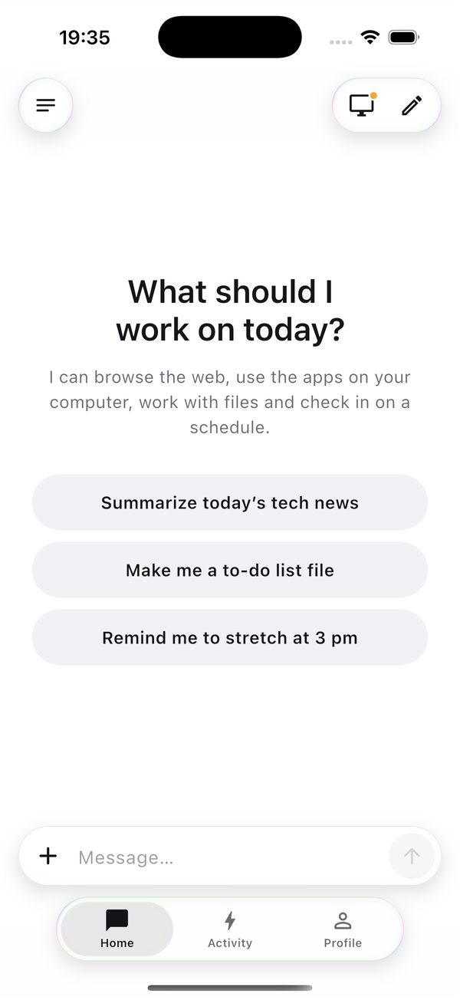
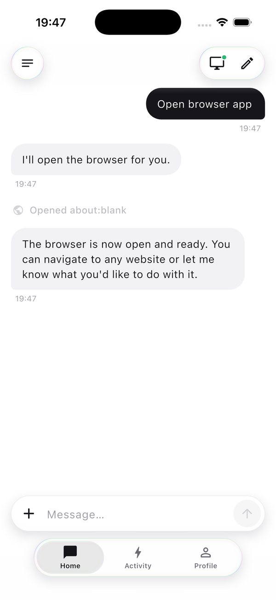
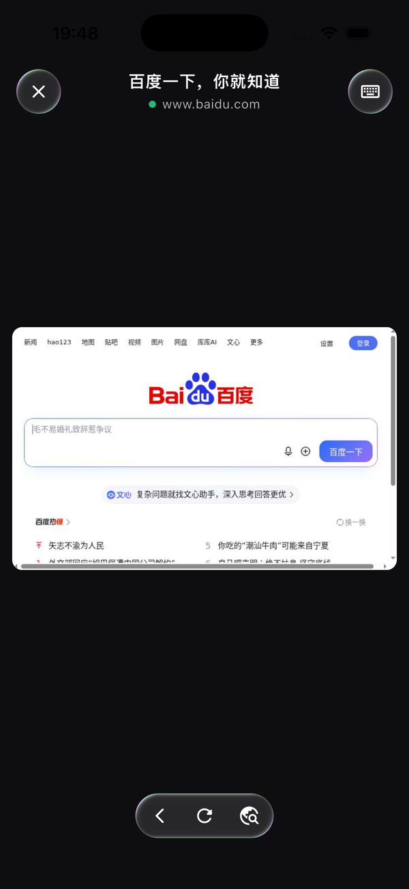
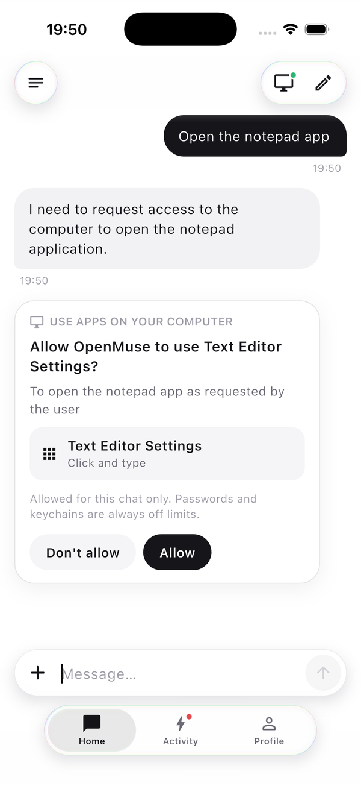
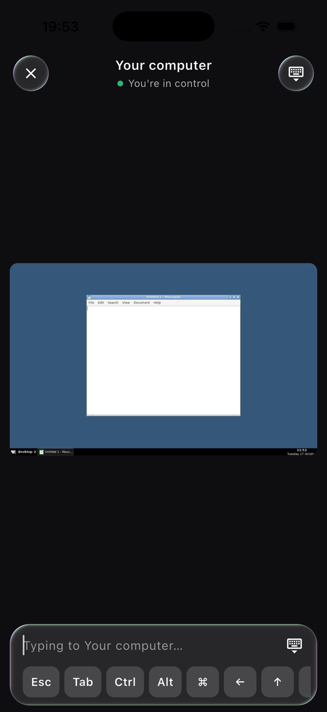
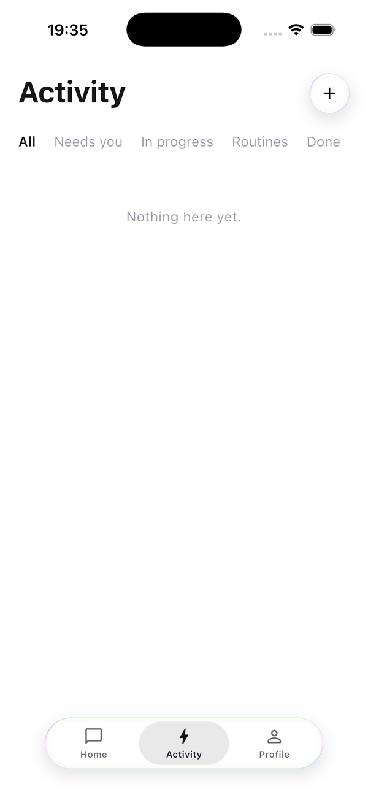
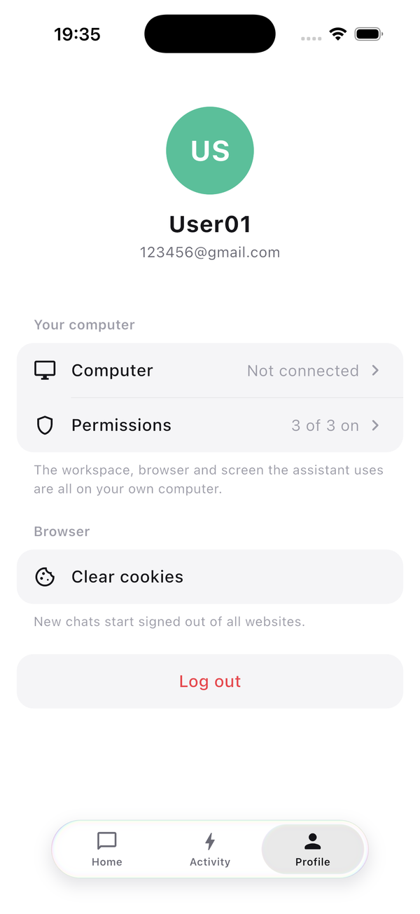

<div align="center">

# Work Agent SDK

[](https://www.python.org/)
[](LICENSE)
[](docs/reference/models.md)
[](docs/reference/mcp.md)
[](docs/reference/skills.md)

</div>

Work Agent SDK is a Python framework for building agents.

## Installation

Requires Python 3.11 or later.

```bash
pip install .
```

## Quick start

```bash
pip install openai
export OPENAI_API_KEY=...
```

```python
import asyncio

from work_agent_sdk import Agent, Runner
from work_agent_sdk.models import OpenAI

agent = Agent("assistant", model=OpenAI("gpt-5"), instructions="You are an assistant.")


async def main():
    async with Runner(agents=[agent]) as runner:
        session = await runner.new_session()
        result = await session.send("Describe Python in one sentence.")
        print(result.text)


asyncio.run(main())
```

## Showcase: OpenMuse

[OpenMuse](examples/showcase/openmuse) is a personal assistant app built on Work Agent SDK, with a backend, a Flutter app and a cloud desktop that runs in Docker.

<table>
  <tr>
    <td align="center" width="25%"><br><sub>Start a chat</sub></td>
    <td align="center" width="25%"><br><sub>The agent opens the browser</sub></td>
    <td align="center" width="25%"><br><sub>Watch live and take over</sub></td>
    <td align="center" width="25%"><br><sub>Approve the apps it can use</sub></td>
  </tr>
  <tr>
    <td align="center" width="25%"><br><sub>Take control of the desktop</sub></td>
    <td align="center" width="25%"><br><sub>Track tasks and routines</sub></td>
    <td align="center" width="25%"><br><sub>Connect your computer</sub></td>
  </tr>
</table>

## Documentation

- [Examples](examples/README.md): how to use each feature
- [API reference](docs/reference/index.md): classes, parameters, attributes and methods

## License

[Apache-2.0](LICENSE)
