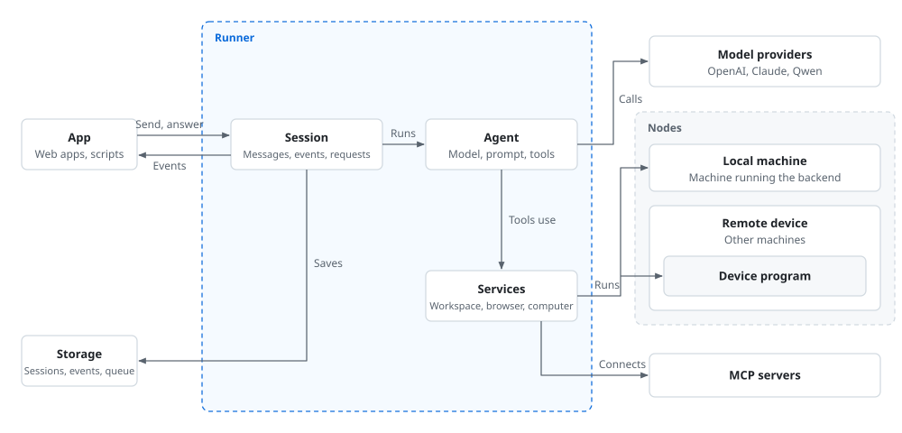

# API reference

Classes, parameters, attributes and methods of Work Agent SDK. For installation and a minimal example see the [README](../../README.md); for how to use each feature see [examples](../../examples).

## Core concepts

| Name | Description |
| :-- | :-- |
| Agent | `Agent`, made up of a model, system prompt, tools and hooks |
| Runner | Runs agents; creates and stores sessions |
| Session | A conversation with an agent |
| Turn | The agent handling one message, from receiving it to giving an answer |
| Tool | A function the agent can call |
| Request | Something during execution that needs an answer from the user or backend before continuing, such as asking the user to confirm an operation |
| Service | Provides resources to sessions, such as a workspace, browser and computer |
| Backend | The application that runs the Runner |
| Node | A machine hosting a workspace, browser or computer; either the local machine or a remote device |
| Local machine | The machine the backend runs on |
| Remote device | Another machine running the device program |

## Pages

| Page | Contents |
| :-- | :-- |
| [Agent](agent.md) | `Agent` |
| [Runner](runner.md) | `Runner` |
| [Sessions](sessions.md) | `Session`, `TurnHandle`, `TurnResult`, `CustomMessage`, events |
| [Models](models.md) | `OpenAI`, `Claude`, `Qwen`, `OpenAICompatible`, `ModelSettings`, `Model` |
| [Tools](tools.md) | `tool()`, `Tool`, `Toolset`, `ToolResult`, `ToolError`, `Context` |
| [Requests](requests.md) | `Request`, `Approval`, `PendingRequest` |
| [Hooks](hooks.md) | `Hooks`, `Deny`, `Reply`, `Continue`, `only_tools()` |
| [Workspace](workspace.md) | `Workspace`, `SRT`, `NoSandbox`, `Shell`, `ViewImage`, `BoundWorkspace` |
| [Browser](browser.md) | `Browser`, `BrowserPolicy`, `BrowserUse`, `BoundBrowser`, `Takeover` |
| [Computer](computer.md) | `Computer`, `ComputerPolicy`, `ComputerUse`, `BoundComputer`, `AppAccess` |
| [Nodes](nodes.md) | `Local`, `Device`, `SharedFolder`, `Nodes`, device program arguments |
| [Subagents](subagents.md) | `Subagents`, `TaskControl`, `TaskResult` |
| [MCP](mcp.md) | `MCP`, `OAuth`, `MCPService`, `Authorization` |
| [Skills](skills.md) | `Skills`, `SKILL.md` fields |
| [Schedules](schedules.md) | `Scheduler`, `ScheduleService`, `ScheduleRecord` |
| [Services](services.md) | `Service`, `RunnerAPI`, `SessionRef` |
| [Storage](storage.md) | `Store`, other storage interfaces, `KeyProvider` |
